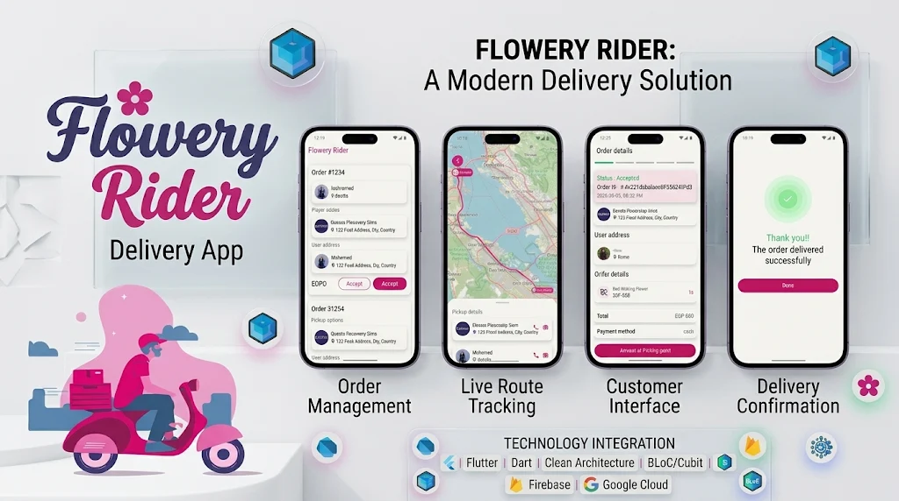

# 🚴 Flowery Rider – A Modern Delivery Management Solution

<p align="center">
  
</p>

**Flowery Rider** is a Flutter-based mobile application designed to simplify and streamline delivery operations. It enables riders to manage delivery orders, track locations through interactive maps, update order statuses in real time, and manage their profiles through a clean and intuitive interface.

Developed collaboratively by a **5-member team**, the project follows Clean Architecture principles and modern Flutter development practices to ensure maintainability, scalability, and testability.

## ✨ Features

- **📦 Order Management:** View incoming delivery requests, accept orders, and manage delivery operations.
- **🗺️ Map Integration:** Interactive maps and location tracking powered by Flutter Map.
- **👤 Rider Profile:** Manage personal information and rider availability.
- **🔄 Delivery Status Management:** Update order statuses throughout the delivery lifecycle.
- **⚡ Firebase Integration:** Backend services and real-time notifications.

## 🛠️ Tech Stack

| Category | Technologies |
|---|---|
| Framework | Flutter & Dart |
| Architecture | Clean Architecture |
| State Management | BLoC / Cubit |
| Networking | Retrofit & Dio |
| Dependency Injection | GetIt & Injectable |
| Maps | Flutter Map |
| Backend Services | Firebase |
| CI/CD | GitHub Actions |
| Testing | Unit Testing & Widget Testing |

## 🏗️ Architecture

The application follows **Clean Architecture**, separating business logic from external dependencies and presentation concerns.

```text
lib/
├── core/
│   ├── network/
│   ├── services/
│   ├── utils/
│   └── theme/
│
├── features/
│   ├── auth/
│   │   ├── data/
│   │   ├── domain/
│   │   └── presentation/
│   │
│   ├── orders/
│   │   ├── data/
│   │   ├── domain/
│   │   └── presentation/
│   │
│   ├── tracking/
│   └── profile/
│
└── main.dart
```

*Note: The structure above illustrates the architectural organization; adjust it to match the actual repository.*

## ⚙️ Getting Started

### Prerequisites

- Flutter SDK
- Dart SDK
- Android Studio or VS Code
- A configured Firebase project (if required by the application)

### Installation

**1. Clone the repository**

```bash
git clone https://github.com/your-username/flowery-rider.git
cd flowery-rider
```

**2. Install dependencies**

```bash
flutter pub get
```

**3. Generate required files**

```bash
dart run build_runner build --delete-conflicting-outputs
```

**4. Run the application**

```bash
flutter run
```

### Firebase Configuration

Configure the Firebase project and add the required platform-specific configuration files before running the application.

## 🧪 Testing

Run the test suite using
